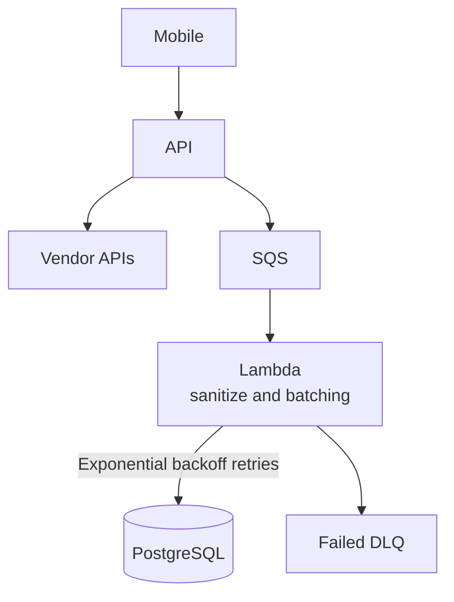

# DESIGN.md

> **POC scope override — 2026-11-06:** The user selected API → PostgreSQL → direct vendor calls, with API and PostgreSQL in separate containers on one Compose network and the vendor on the host. Queue/fan-out/Lambda/DLQ/batching portions below are future reference. The current POC baseline is in [docs/tech-stack.md](docs/tech-stack.md), [docs/infrastructure.md](docs/infrastructure.md), and [docs/guardrails.md](docs/guardrails.md). Deduplicate by stable messageId before starting vendor delivery; duplicate submissions must not trigger another send.

## 1. Purpose

This document describes the broader infrastructure target represented by the architecture diagram; the POC override above defines the current implementation scope. It is intended to serve as a living design record for implementation, review, operations, and future refinement.

The diagram currently represents an asynchronous processing architecture with a mobile client, an API, Amazon SQS, an AWS Lambda worker, vendor APIs, PostgreSQL, and a failed-message dead-letter queue.

> **Scope note:** This document is grounded in the components and connections visible in the diagram. Details that are not represented are explicitly marked as assumptions or decisions required.

## 2. Design Goals

The design is intended to:

- Accept requests from a mobile application through an API.
- Decouple queued processing from request handling with SQS.
- Sanitize and batch work in a Lambda-based worker.
- Integrate with external vendor APIs.
- Persist or retry processing-related data with PostgreSQL.
- Isolate failed messages in a dead-letter queue.
- Support observable, recoverable, and independently scalable workloads.

## 3. Architecture Overview

### 3.1 Logical Topology

### 3.2 Component Inventory

| Component | Role | Type | Primary responsibility |
|---|---|---|---|
| Mobile | Client | Application client | Initiates requests and consumes API responses |
| API | Synchronous entry point | Service/API | Validates requests and coordinates downstream operations |
| SQS | Asynchronous buffer | Managed queue | Decouples intake from worker processing |
| Lambda | Worker | Serverless compute | Sanitizes and batches queued work |
| Vendor APIs | External dependency | Third-party services | Provides external integration capabilities |
| PostgreSQL | Relational data store | Database | Stores application or processing data |
| Failed DLQ | Failure sink | Dead-letter queue | Holds messages that cannot be processed successfully |

## 4. Request and Processing Flows

### 4.1 Mobile to API

1. The mobile client sends a request to the API.
2. The API authenticates and authorizes the request.
3. The API validates the request envelope and business fields.
4. The API returns a synchronous response or acknowledgement.

The diagram does not specify the API protocol, authentication mechanism, versioning strategy, or response contract. These should be defined as part of the API design.

### 4.2 API to Vendor APIs

The current diagram shows a direct connection from the API to Vendor APIs.

This implies that at least one vendor interaction is synchronous or is initiated directly during API request handling. The design must define:

- Which vendor operations are called synchronously.
- Client and upstream timeout limits.
- Retry behavior for vendor failures.
- Idempotency behavior for repeated requests.
- How vendor latency affects API latency.
- Whether vendor failures are returned directly to the mobile client or converted into an asynchronous workflow.

### 4.3 API to SQS

1. The API creates an asynchronous work item.
2. The API publishes the work item to SQS.
3. SQS retains the message until the worker successfully processes it or the message is redriven.
4. The API acknowledges the request according to the API contract.

The implementation should define whether queue publication is required before the API returns success. If PostgreSQL and SQS are both part of one business transaction, an outbox or reconciliation pattern should be considered.

### 4.4 SQS to Lambda

1. SQS invokes Lambda through an event source mapping.
2. Lambda receives one message or a batch of messages.
3. Lambda validates the event envelope.
4. Lambda sanitizes the input.
5. Lambda batches compatible work items according to business and vendor constraints.
6. Lambda performs downstream processing.
7. Successfully processed messages are acknowledged.
8. Failed messages are retried or sent to the Failed DLQ according to queue and event-source configuration.

### 4.5 Lambda to PostgreSQL

The updated diagram shows Lambda connected to PostgreSQL with the label **Exponential backoff retries**.

This is interpreted as Lambda retrying database-related operations with exponential backoff. The implementation should clarify whether the retry applies to:

- Connection establishment.
- Reads or writes.
- Transaction commits.
- Deadlocks or serialization conflicts.
- Temporary network failures.
- Database failover events.

Retries must be bounded, use jitter, and avoid multiplying load during a database outage.

### 4.6 Lambda to Failed DLQ

Lambda sends unprocessable or repeatedly failing work to the Failed DLQ. The design should distinguish:

- Permanent validation failures.
- Non-retryable authorization or contract failures.
- Transient vendor failures.
- Transient database failures.
- Worker defects or unexpected exceptions.

Failure classification should be recorded with a correlation ID, message ID, failure category, and redacted diagnostic context.

## 5. Component Design

### 5.1 Mobile Client

**Responsibilities**

- Initiate API requests.
- Present request status to the user.
- Handle acknowledgement, success, timeout, and error responses.
- Avoid unsafe client-side assumptions about eventual processing completion.

**Required design decisions**

- API base URL and environment selection.
- Authentication and token renewal.
- Request timeout and retry policy.
- Idempotency key generation.
- Offline or intermittent-connectivity behavior.
- User-visible status for asynchronous work.

### 5.2 API

**Responsibilities**

- Authenticate and authorize callers.
- Validate request schemas and business rules.
- Generate or propagate correlation IDs.
- Invoke Vendor APIs when the operation is synchronous.
- Publish asynchronous work to SQS.
- Persist required state to PostgreSQL, if applicable.
- Return stable, versioned response contracts.

**Non-functional requirements**

- Bounded request latency.
- Rate limiting and abuse protection.
- Structured logging.
- Request tracing.
- Safe error responses without sensitive details.
- Idempotent handling of repeated requests.

### 5.3 SQS

**Responsibilities**

- Buffer asynchronous work.
- Smooth traffic bursts.
- Decouple API availability from Lambda processing capacity.
- Support redelivery after unsuccessful processing.
- Redrive repeatedly failing messages to the Failed DLQ.

**Settings to define**

- Standard versus FIFO queue.
- Message retention period.
- Visibility timeout.
- Maximum receive count.
- Batch size and batching window.
- Encryption and queue policy.
- Producer and consumer permissions.
- Ordering and deduplication requirements.

The visibility timeout should exceed the maximum expected Lambda processing duration, including downstream calls and bounded retries.

### 5.4 Lambda: Sanitize and Batching

**Responsibilities**

- Consume SQS events.
- Validate and sanitize input.
- Normalize fields and formats.
- Group compatible records into batches.
- Enforce batch size, payload size, and vendor limits.
- Persist processing state when required.
- Classify errors as retryable or permanent.
- Emit metrics and structured logs.

**Batching considerations**

- Do not batch records with incompatible authorization, tenant, or routing context.
- Preserve per-record failure information when partial batch failure is possible.
- Ensure a failed batch does not incorrectly acknowledge successful records.
- Define maximum batch age and size.
- Respect vendor rate limits and request quotas.

**Runtime settings to define**

- Runtime and version.
- Memory allocation.
- Timeout.
- Reserved or maximum concurrency.
- SQS batch size.
- Partial-batch response behavior.
- Environment variables.
- Secrets access.
- VPC and network placement.
- Dead-letter and alarm behavior.

### 5.5 Vendor APIs

Vendor APIs are external dependencies and should be treated as unreliable boundaries.

**Required integration controls**

- Endpoint and operation inventory.
- Authentication method and credential rotation.
- Request and response schemas.
- Timeout values.
- Retryable status codes.
- Rate-limit handling.
- Idempotency keys.
- Circuit-breaking or load-shedding behavior.
- Vendor outage response.
- Data-sharing and privacy review.

The diagram shows Vendor APIs connected directly to the API, not to Lambda. If the intended design is for Lambda to call vendors asynchronously, the diagram and this document should be updated to show that relationship.

### 5.6 PostgreSQL

PostgreSQL is shown as a database dependency of Lambda, with an exponential-backoff retry relationship.

**Potential responsibilities**

- Store processing state.
- Store normalized records.
- Maintain idempotency records.
- Track vendor request outcomes.
- Support reconciliation and operational reporting.

**Required database decisions**

- Hosting model and region.
- High availability and failover.
- Schema ownership.
- Migration and rollback strategy.
- Connection pooling.
- Maximum connections under Lambda concurrency.
- Transaction boundaries.
- Backup and point-in-time recovery.
- Encryption and network access.
- Retention and deletion policies.

### 5.7 Failed DLQ

The Failed DLQ is the operational boundary for messages that cannot be successfully processed.

**Required behavior**

- Preserve the original message and failure metadata.
- Prevent poison messages from blocking normal work.
- Trigger an alarm when messages arrive.
- Support controlled replay after remediation.
- Prevent duplicate side effects during replay.
- Apply retention and access controls.

**DLQ runbook**

1. Identify the failure category.
2. Determine whether the issue is data, code, permission, vendor, database, or configuration related.
3. Remediate the root cause.
4. Validate the fix in a non-production environment where possible.
5. Replay selected messages with safeguards.
6. Confirm successful processing and clear the incident.
7. Document recurring failures and update tests or alarms.

## 6. Reliability Design

### 6.1 Idempotency

At-least-once delivery and retries can produce duplicate processing. The API and Lambda paths should use idempotency keys or deterministic business identifiers to prevent duplicate side effects.

Idempotency records should include the key, operation, status, creation time, and result reference where appropriate.

### 6.2 Retry Policy

Retries should be applied only to transient failures. Recommended controls:

- Exponential backoff.
- Randomized jitter.
- Maximum attempt count.
- Maximum elapsed retry time.
- Per-dependency retry budgets.
- Explicit non-retryable error classification.
- Metrics for retry volume and exhaustion.

The diagram explicitly labels the Lambda-to-PostgreSQL relationship as exponential backoff retries. Retry parameters remain to be specified.

### 6.3 Partial Failure

The design has multiple independently failing boundaries: API, Vendor APIs, SQS, Lambda, PostgreSQL, and the DLQ path. Each boundary requires a defined outcome for partial success.

Examples include:

- Database write succeeds but queue publication fails.
- Vendor request succeeds but response is lost.
- One item in a Lambda batch fails while others succeed.
- A message is retried after a downstream side effect already occurred.

### 6.4 Backpressure

SQS provides buffering, but downstream systems still require protection. Lambda concurrency, batch size, and vendor request rate should be tuned together. PostgreSQL connection limits must be evaluated against the maximum number of concurrent Lambda invocations.

## 7. Security Design

- Use TLS for client, API, queue, database, and vendor communication where supported.
- Apply least-privilege IAM policies to API, Lambda, SQS, DLQ, and secrets access.
- Store credentials in a managed secrets solution.
- Rotate vendor and database credentials.
- Encrypt data at rest for SQS and PostgreSQL.
- Validate and sanitize all client-controlled input.
- Avoid sensitive payloads in logs and metrics.
- Restrict DLQ access because messages may contain sensitive data.
- Separate environments, accounts, credentials, queues, and databases.
- Apply network egress controls to external vendor traffic.
- Define data classification, retention, and deletion requirements.

## 8. Observability

### 8.1 Required Correlation Data

Propagate a non-sensitive correlation ID across the API request, SQS message, Lambda invocation, database operations, vendor calls, and DLQ records.

### 8.2 Logs

Recommended structured fields:

- Correlation ID.
- Request ID.
- Message ID.
- Tenant or business identifier in redacted form.
- Component.
- Processing stage.
- Batch size.
- Retry attempt.
- Error category.
- Duration.
- Outcome.

### 8.3 Metrics

Track at minimum:

- API request count, latency, and error rate.
- Vendor request count, latency, status, and timeout rate.
- SQS queue depth and oldest-message age.
- Lambda invocations, duration, errors, throttles, and concurrency.
- Batch success and partial failure rates.
- PostgreSQL connection errors, query latency, and transaction failures.
- Retry count by dependency and reason.
- Failed DLQ message count and age.
- End-to-end processing latency.

### 8.4 Alerts

Recommended alerts include:

- Elevated API error or latency rate.
- Vendor timeout or rate-limit spike.
- Queue age above service-level threshold.
- Lambda throttling or sustained error rate.
- PostgreSQL connection exhaustion.
- Non-zero Failed DLQ depth.
- Retry exhaustion.
- Growing backlog despite available worker capacity.

## 9. Scalability and Capacity

- Scale API capacity independently from Lambda workers.
- Use SQS to absorb short-lived traffic bursts.
- Set Lambda concurrency limits based on vendor quotas and database capacity.
- Use batching only within vendor payload and latency limits.
- Monitor queue age in addition to queue depth.
- Load-test the API, queue, worker, vendor boundary, and database together.
- Estimate worst-case retry amplification during dependency outages.
- Define a maximum acceptable backlog and recovery rate.

## 10. Deployment and Change Management

The implementation should use repeatable, reviewed infrastructure and application deployments.

**Required practices**

- Infrastructure as code for queues, DLQs, Lambda configuration, IAM, networking, and database resources.
- Separate development, staging, and production environments.
- Versioned API and message schemas.
- Backward-compatible consumer changes where messages may be in flight.
- Safe database migrations.
- Automated unit, integration, contract, and end-to-end tests.
- Deployment health checks.
- Rollback or roll-forward procedures.
- Configuration and secret change auditing.
- Vendor contract and schema change tracking.

## 11. Disaster Recovery and Continuity

Define and test:

- Recovery time objective.
- Recovery point objective.
- PostgreSQL backup and restore process.
- Queue and DLQ recovery behavior.
- Replay and deduplication strategy.
- Vendor outage handling.
- Regional failure response.
- Credential and configuration restoration.
- Operational ownership and escalation paths.

## 12. Testing Strategy

### Unit Tests

- Request validation.
- Sanitization and normalization.
- Batch construction.
- Retry classification.
- Idempotency.
- Error mapping.
- DLQ metadata generation.

### Integration Tests

- API to Vendor APIs.
- API to SQS.
- SQS event source to Lambda.
- Lambda to PostgreSQL.
- Failed message redrive and replay.
- Secret and permission boundaries.

### Resilience Tests

- Vendor timeout and rate limiting.
- PostgreSQL failover or temporary unavailability.
- Queue permission failure.
- Lambda timeout.
- Duplicate delivery.
- Partial batch failure.
- Poison message.
- DLQ replay.
- Sudden traffic burst.

## 13. Open Decisions and Diagram Gaps

The following items are not resolved by the current diagram:

1. Is the API-to-Vendor API path synchronous by design?
2. Should Lambda call Vendor APIs instead of, or in addition to, the API?
3. What data is stored in PostgreSQL, and which component owns each write?
4. Does the exponential-backoff retry label apply only to PostgreSQL operations, or to all Lambda downstream operations?
5. Is the SQS queue Standard or FIFO?
6. What is the redrive policy and maximum receive count?
7. What are the API authentication and authorization mechanisms?
8. What are the vendor authentication, timeout, and quota policies?
9. What are the Lambda batch size, timeout, and concurrency limits?
10. How are partial batch failures acknowledged?
11. What is the source of truth for processing state?
12. What is the replay and idempotency strategy?
13. What are the deployment regions, environments, and network boundaries?
14. What are the data retention, privacy, and compliance requirements?
15. What are the service-level objectives and ownership model?

## 14. Acceptance Criteria

The design is ready for implementation when:

- All component owners are identified.
- API and message contracts are versioned.
- Synchronous and asynchronous responsibilities are explicit.
- Database ownership and transaction boundaries are documented.
- Retry, timeout, and idempotency rules are approved.
- SQS and DLQ settings are defined.
- Lambda batching and partial-failure behavior are tested.
- Vendor dependency limits are documented.
- Security and data classification reviews are complete.
- Dashboards, alerts, and runbooks are available.
- Disaster recovery objectives are approved.
- The diagram and this DESIGN.md describe the same topology.

## 15. Change Log

| Date | Change |
|---|---|
| 2026-11-06 | Regenerated DESIGN.md from the updated diagram. Lambda is labeled “sanitize and batching”; Vendor APIs are shown connected directly to API; PostgreSQL is shown connected to Lambda with exponential-backoff retries. |

