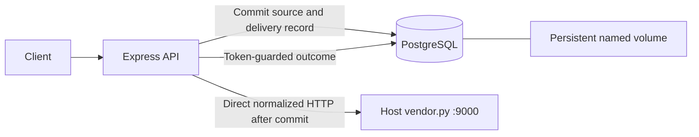

# POC infrastructure and direct delivery

Implemented topology: Node.js/Express API and PostgreSQL containers share one Compose bridge network; the unchanged Python vendor runs on the host. The POC override in DESIGN.md excludes fan-out, SQS, Lambda, DLQ, batching and background consumers. All new runtime source/support lives under app/; root Makefile is the entry point.

## Addresses and startup

API listens on0.0.0.0:3000 inside its container; only host127.0.0.1:3000 is published. Database is db:5432 on the shared bridge and has no published host port. The API uses http://host.docker.internal:9000 for the host vendor. Container127.0.0.1 refers to that container, not the host. Docker Desktop provides the host alias; optional compose.linux.yaml supplies host-gateway mapping for plain Linux Engine. Linux routing was not runtime-tested.

The fixed vendor binds host127.0.0.1 and supports --port only. Direct reachability from the API was verified on this Docker Desktop installation. A restricted host TCP forwarder is a conditional fallback on installations where the loopback listener is not reachable; do not edit vendor.py or expose its control endpoints publicly. Do not switch to host networking or an internal-only bridge as an accidental workaround. See [Docker networking](https://docs.docker.com/compose/how-tos/networking/).

make up creates ignored local credentials once, starts/waits for DB, runs versioned migrations001/002 as the non-superuser application role, then builds/starts the non-root read-only API. profiles.json is mounted read-only and validated once at startup. Readiness checks source/delivery table columns; vendor availability does not control DB readiness. Ordinary shutdown preserves the named volume. API shutdown has20-second drain limit and25-second Compose grace.

## Persistence, deduplication and delivery

POST /events validates one README source event, constructs its canonical retained-source hash and safe vendor projection, and commits events/event_deliveries in one short transaction. INSERT ON CONFLICT plus the unique message_id distinguishes new intake, identical duplicates and409 changed-content conflicts. Duplicates reuse saved state without initiating dispatch. Existing source rows without delivery metadata are protected reconciliation cases.

Only new eligible events dispatch directly. Ineligible names are stored as skipped. Each sender claims a60-second UUID token in a short atomic update; each attempt records current ownership durably, then releases DB work before HTTP. Frozen payloads and unchanged messageIds survive retries/profile changes. Outcomes update only under the current token; a stale owner cannot overwrite newer results.

Known transient failures retry at most3 times by default with2-second attempt timeout and bounded jitter/rate-limit waits under a15-second processing cancellation budget.400/422 and other permanent rejections are terminal. HTTP acceptance with an unknown/lost response or failed outcome recording remains uncertain/sending; PostgreSQL cannot atomically include an external HTTP side effect.

GET /events/:id exposes safe status. POST /events/:id/retry is the explicit queue-free recovery trigger for pending/transient/uncertain work and expired claims. No scheduler automatically drains records. Replayed calls retain vendor idempotency identity; exactly-once network delivery is not promised. See [contracts](api-contracts.md), [data model](data-model.md), and [interactions](interactions.md).

## Safety, bounds and observation

Keep the DB private, app role non-superuser, API non-root, credentials out of images/logs, SQL values parameterized and the vendor destination configuration-controlled. Raw context/traits/contact data never enter logs or outbound metadata. Body64KiB, nesting20, response8KiB, pool5 and active event routes16 are bounded. Transaction timeout5seconds and lock timeout1second protect intake; no transaction/row lock spans HTTP or backoff. Correlation UUID headers, safe outcome codes, attempt counts, internal event UUIDs and durations provide observation without logging raw source data.

Actual checks: healthy containers; real app-role DB access; persisted source schema;17 unit/HTTP tests;24 schema checks;10 PostgreSQL/HTTP integration scenarios; strict vendor smoke with six concurrent requests and one vendor delivery; retained failures and dedup after API restart. When the user reported connectivity trouble, GET /_stats from inside api returned200 with mode500. Restoring modeok and explicitly retrying the user's saved event produced delivered/vendor200 on cumulative attempt4. The alias was working; no URL rewrite or local relay was necessary. Pending extended checks and test-process cleanup are in [poc.md](../poc.md).
