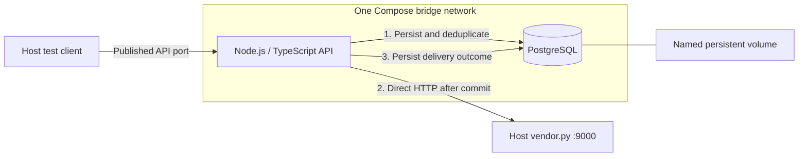

# POC infrastructure and direct delivery

Status: user-selected topology recorded; the explicitly requested Compose/Express health skeleton is implemented and verified. Product architecture is in progress; the initial source-event schema is now implemented; incoming event HTTP contracts and event processing remain unimplemented. Sources: [DESIGN.md](../DESIGN.md), the user's explicit POC narrowing, and the subsequent API/database container requirement on 2026-11-06. This POC override governs implementation scope; DESIGN.md remains the broader future reference.

## Topology

| Component | Responsibility | Execution / addressing |
| --- | --- | --- |
| api | Intake, normalization, persistence coordination, direct vendor call, outcomes | Node.js container; listen on 0.0.0.0 inside container, publish chosen API port on host 127.0.0.1 |
| db | Accepted events, idempotency and delivery outcome durability | PostgreSQL container on the same network; api uses db:5432, never its own localhost |
| psql | Database inspection and later migration/diagnostic operations | Run inside db; publishing the database port is unnecessary |
| Database volume | Preserve data across API/database restarts and ordinary shutdown | Named volume; exact mount depends on selected PostgreSQL image/version |
| Vendor stub | Fixed downstream service, strict validation, injectable failures | Host process, normally 127.0.0.1:9000; API targets http://host.docker.internal:9000 when reachable |
| Profiles fixture | Resolve UUID to internal profile identity | Existing profiles.json; load/validate once at startup or through an explicitly designed adapter; no per-request synchronous file reads |

No SQS, Lambda, worker, DLQ, fan-out, batch delivery, cache, or queue replacement is part of this POC. PostgreSQL retains unfinished outcomes; it is not being turned into a polling queue. A future recovery operation may call the same delivery flow explicitly.

## Container-to-host connectivity

Use one ordinary project bridge network for api and db. Container-to-container traffic uses service names and container ports. Do not use fixed container IPs, host networking, or an internal-only shared network that removes the API's host egress. Docker documents these behaviors in [Compose networking](https://docs.docker.com/compose/how-tos/networking/).

On Docker Desktop, host.docker.internal is supplied by Docker. Plain Linux Engine generally needs the API service's extra_hosts mapping host.docker.internal:host-gateway. This mapping supplies an address; it does not make a loopback-only host listener reachable by itself. See [Docker host-gateway documentation](https://docs.docker.com/reference/cli/docker/container/run/#add-entries-to-container-hosts-file---add-host).

Important seed constraint: vendor.py binds explicitly to 127.0.0.1 and offers only --port, not --host. Do not edit it. At setup, verify a read-only GET /_stats from inside api, not just from the host. A read-only probe from the running API container verified direct access to the loopback listener on this Docker Desktop installation with strict validation enabled; no relay was needed. Repeat that check on another machine rather than assuming all Docker engines share this behavior. If it fails, keep the vendor unchanged and configure a host-side TCP forwarder from a Docker-reachable interface/alternate port to 127.0.0.1:9000; point the API at that alternate port and restrict the relay to local Docker access. The forwarder is a conditional transport fallback, not another processing service. Do not silently expose vendor control endpoints to the LAN or claim the alias alone solves binding.

The same configured vendor destination must be used for tests and application calls. localhost inside api refers to api itself, not db or the host. If a host relay is required, record its exact binding, alternate port, startup/cleanup and firewall scope in environment documentation during setup.

## Planned event request flow and consistency

The current Express skeleton exposes health/readiness only. The event flow below remains the required future behavior. The initial source-event table exists; no event intake/delivery code is implemented.

1. Validate the source event, check its event name against the supplied seven-name allowlist, and derive a safe normalized payload under [prd.md](prd.md). Invalid or ineligible events produce no vendor traffic; exact intake handling of ineligible names remains a contract decision.
2. Use source messageId as the database-enforced unique event identity and persist the accepted event plus enough replay information. A duplicate submission reuses existing state instead of initiating a new vendor call; an existing failed/uncertain attempt requires the explicit retry/recovery path, not automatic redispatch just because the client submitted again. Reject same-ID/different-content conflicts. Coordinate concurrent admission atomically in the database before dispatch. Await successful database commit before any vendor side effect. A failed or uncertain commit does not authorize delivery; reconcile first.
3. Call the configured vendor POST /events directly within the request's finite time budget. No active DB transaction, row lock, or checked-out transaction connection may span the HTTP call or retry delay.
4. Persist the observed vendor outcome in a new short database operation. Return a contract-defined result that distinguishes retained input from confirmed downstream delivery. Response status codes/shapes belong in [api-contracts.md](api-contracts.md), not this topology document.

A database transaction cannot atomically include the external HTTP side effect. Do not claim exactly-once delivery or roll back retained input to conceal a vendor failure. Duplicate requests must resolve through durable identity/concurrency controls; an in-memory map or check-then-insert alone is insufficient. Concrete constraints/claiming mechanics belong to data design.

## Partial failures and recovery

| Boundary / observation | Required POC behavior |
| --- | --- |
| Input invalid | No vendor call; visible safe validation error |
| Initial DB write fails or commit outcome is unknown | No vendor call until confirmed durable; safe failure/reconciliation |
| Event committed, process exits before vendor call | Retained unfinished work remains inspectable and eligible for explicit recovery |
| Vendor 400 rejection / 422 validation failure | Retain permanent failure; do not retry unchanged payload |
| Vendor 429 / 500 / 504 or retryable network failure | Bounded retries within the request deadline; otherwise retain an unfinished or retry-exhausted outcome |
| Timeout/reset may have followed downstream acceptance | Outcome is uncertain; preserve messageId for any replay, do not assert the vendor did not receive it |
| Vendor accepts, then local outcome update fails or process exits | Database may still show unfinished work; expose/reconcile uncertainty and replay only with original messageId |
| Repeat of already confirmed delivery | Return/reconcile existing result without a fresh side effect; changed content under the same identity must not silently overwrite it |

No scheduler or worker automatically drains retained failures. The concrete trigger for recovery (for example a same-ID request explicitly designated as recovery, or an operator replay operation), concurrent in-progress handling, and stale-attempt recovery remain decisions for data/contracts design. The accepted restart-recovery criterion remains required; durable storage alone is not evidence that it works. Recovery must reuse the agreed original outbound representation so a changed profile mapping does not silently change the same event on retry.

The stub's timeout mode returns 504 after 30 seconds without accepting the event, so it does not demonstrate lost-response-after-acceptance behavior. Model that boundary separately in the later test harness.

## Retry, capacity, and observation controls

- One layer owns vendor retries. Classify status/network failures explicitly; use finite per-attempt timeouts, an overall request budget, bounded attempts, backoff with jitter, and a total elapsed cap. Do not stack HTTP-client and application retry loops.
- The stub supplies retry_after in the 429 JSON body. Honor that delay when valid and within the remaining budget; real-provider Retry-After handling must be contract-based. If the delay exceeds the budget, retain the outcome for later recovery instead of sleeping indefinitely.
- Pin concrete limits before implementation: request size, DB pool/acquisition/query timeouts, vendor concurrency, per-attempt deadline, total request budget, attempts and delay caps. For the fixture timeout exercise, choose an attempt timeout shorter than 30 seconds.
- Apply bounded admission and reject overload visibly. Do not accumulate an unbounded list of promises or retries in memory. Vendor latency now contributes directly to API latency.
- Record sanitized correlation/message IDs, stage, attempt, durations, vendor status, final outcome and failure category. Never log event bodies, credentials, contact details, advertising IDs, or raw vendor error bodies.
- Measure API/vendor latency, errors, retry counts, DB pool pressure, and retained unfinished/terminal outcomes. Queue-depth/Lambda/DLQ metrics from DESIGN.md are future-only.

## Setup and security requirements

Use a non-root API process, a non-superuser application DB role, parameterized SQL, ignored local credentials, and a configured vendor destination that client data cannot override. Publish only the API port to host loopback by default. Keep PostgreSQL private to the Compose network; inspect it using psql in db. Local HTTP to the exercise stub is intentional; external deployment and TLS/auth policies need a separate design.

During setup, add DB health/readiness checks and ensure application startup waits for usable DB connectivity and schema readiness with a finite deadline. Check vendor reachability independently; a temporary vendor outage is a delivery failure, not proof that retained data is corrupt. Compose does not start the host vendor. Document host startup and validate it with strict enabled.

Ordinary shutdown must preserve the named database volume. Destructive resets must be separate and explicit. Drain or stop admission on shutdown, bound completion time, close DB/HTTP resources, and leave interrupted work recoverable.

## Actual setup verification and remaining work

Implemented app/compose.yaml with api/db, one bridge network, a private PostgreSQL port, host-loopback-published API port 3000, DB health dependency, non-root read-only API runtime, and PostgreSQL 18 named volume. app/compose.linux.yaml optionally supplies the plain Linux host-gateway mapping. The API is Express/TypeScript with /health and /ready; readiness performs SELECT 1 as event_relay_app, not an event-schema check. The DB bootstrap SQL creates the application role only, with no product tables.

Actual checks passed: quiet Compose validation (base and Linux override), TypeScript build, five health/configuration tests on both host Node and pinned container Node, clean-volume DB bootstrap in a disposable project, healthy api/db startup, API-to-DB connectivity as non-superuser, API process UID 1000, strict host-vendor GET /_stats, readiness 503 during DB shutdown while liveness stayed 200, and readiness recovery with the same database cluster identity after restart. The disposable verification volume was removed; the main database volume and healthy services were retained.

The first shell-based DB bootstrap failed with an executable bind-mount error. It was replaced by psql SQL using environment lookup, verified on a fresh volume; the initially interrupted local bootstrap was repaired explicitly without deleting its volume.

Product tests must still cover the planned event failure table, concurrent duplicate submissions, and explicit replay after restart. Current health checks do not establish those behaviors. See [testing.md](testing.md) and [environment.md](environment.md) for actual commands/configuration. Exact setup pins are in [tech-stack.md](tech-stack.md); product retry budgets, schema, intake contracts, auth, and recovery mechanisms remain open. The bounded runtime request does not complete all design dependencies or the full setup-dev phase.

## Initial events storage

The user reviewed the README fields and added a UUID row key. The running POC now has public.events from [the versioned migration](../app/db/migrations/001_create_events.sql): internal UUID id, unique text message_id, source scalar fields, timezone-aware times, and nullable object-constrained properties/context JSONB. Bootstrap still only creates the role; run make db-migrate explicitly after startup. The migration does not send events, clear data, or add a queue. make test-db creates a temporary schema-test container, rolls back all synthetic inserts, and removes that container; it is not a background worker. All 24 checks passed, and the running API remained ready. Delivery-state/dispatch ownership and explicit recovery remain future design work.
